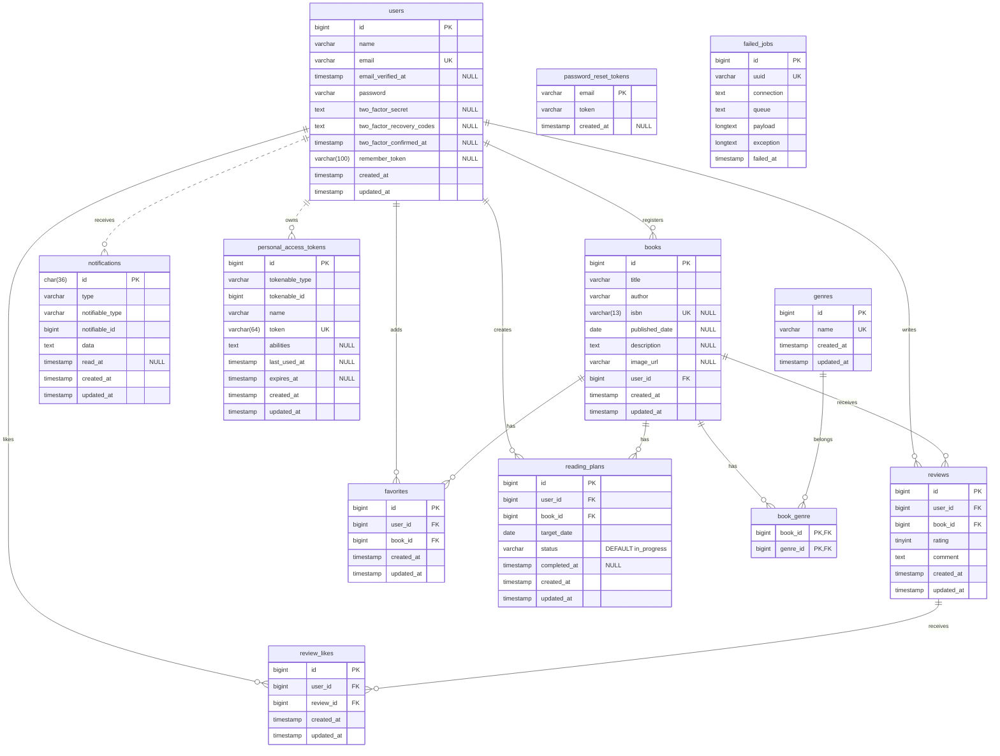

# BookShelf 書籍レビューアプリ

## 概要

BookShelfは、書籍の管理やレビュー投稿を通じて、
ユーザーの読書活動をサポートするWebアプリケーションです。

Bladeとセッション認証を使用したWebアプリケーションに加え、
外部アプリケーション向けのREST APIを提供しています。

## 機能一覧

### 基本機能

- ユーザー登録・ログイン・ログアウト
- 書籍一覧・詳細表示
- 書籍登録・編集・削除
- レビュー投稿・編集・削除
- お気に入り登録・解除
- レビューへのいいね
- 書籍ランキング
- ジャンル管理
- REST APIによる書籍管理

### 応用機能

- キーワード検索・ジャンル検索
- 書籍の並び替え
- Google Books APIによるISBN検索
- マイ読書レポート
- 読書計画管理
- 読書計画の期限切れ自動更新
- リマインダー通知・既読管理
- Laravel SanctumによるAPIトークン認証

## 使用技術

- PHP 8.5.9
- Laravel 10.50.3
- MySQL 8.4
- Node.js 24.19.0
- Blade
- Tailwind CSS 3.4
- Alpine.js 3
- Vite 5
- Laravel Fortify
- Laravel Sanctum
- Laravel Sail
- Docker / Docker Compose
- phpMyAdmin
- PHPUnit
- Laravel Pint
- Google Books API

## 環境構築

### 1. リポジトリのクローン

```bash
git clone https://github.com/shunyahakamata/bookshelf.git
cd bookshelf
```

### 2. Composer依存パッケージのインストール

Dockerを起動した状態で、以下を実行してください。

```bash
docker run --rm \
  -u "$(id -u):$(id -g)" \
  -v "$(pwd):/var/www/html" \
  -w /var/www/html \
  -e COMPOSER_CACHE_DIR=/tmp/composer_cache \
  laravelsail/php85-composer:latest \
  composer install
```

### 3. 環境変数の設定

```bash
cp .env.example .env
```

.envファイルの以下の項目を変更してください。

```dotenv
APP_NAME=BookShelf
APP_URL=http://localhost

DB_CONNECTION=mysql
DB_HOST=mysql
DB_PORT=3306
DB_DATABASE=laravel
DB_USERNAME=sail
DB_PASSWORD=password
```

### 4. Laravel Sailの起動

```bash
./vendor/bin/sail up -d
```

必要に応じて、Sailのエイリアスを設定してください。

```bash
alias sail='[ -f sail ] && bash sail || bash vendor/bin/sail'
```

以降のコマンドは、プロジェクトのルートディレクトリで
実行してください。

### 5. アプリケーションキーの生成

```bash
sail artisan key:generate
```

### 6. データベースの構築

```bash
sail artisan migrate --seed
```

初期データとして、ユーザー、ジャンル、書籍、
レビュー、お気に入り、いいね、読書計画が登録されます。

### 7. フロントエンドのセットアップ

```bash
sail npm ci
sail npm run dev
```

Vite開発サーバーは起動した状態にしてください。

## 開発環境URL

| 項目 | URL |
| --- | --- |
| アプリケーション | http://localhost |
| phpMyAdmin | http://localhost:8080 |
| API | http://localhost/api/v1/books |

## テスト用アカウント

| 名前 | メールアドレス | パスワード |
| --- | --- | --- |
| 山田太郎 | yamada@example.com | password |
| 鈴木花子 | suzuki@example.com | password |
| 田中一郎 | tanaka@example.com | password |
| 佐藤美咲 | sato@example.com | password |
| 高橋健太 | takahashi@example.com | password |

上記は開発・動作確認用のアカウントです。

## Google Books APIの設定

ISBN検索機能を使用する場合は、
Google CloudでBooks APIを有効化し、
取得したAPIキーを.envファイルに設定してください。

```dotenv
GOOGLE_BOOKS_API_KEY=取得したAPIキー
```

設定変更後は以下を実行してください。

```bash
sail artisan config:clear
```

APIキーはGitの管理対象に含めないでください。

## 読書計画・リマインダー通知

読書計画は以下の3つの状態で管理します。

| 状態 | 説明 |
| --- | --- |
| in_progress | 進行中 |
| completed | 読了済み |
| expired | 期限切れ |

日次バッチでは、期限切れの自動更新と
リマインダー通知の生成を行います。

通知は以下のタイミングで生成されます。

- 目標日の3日前（進行中）
- 目標日当日（進行中）
- 目標日の3日後（期限切れ）

通知はデータベースに保存されます。

### 日次バッチの手動実行

```bash
sail artisan reading-plans:run-daily
```

手動で同日に繰り返し実行すると、
同じ通知が複数生成される場合があります。

### スケジューラー

日本時間の毎日20時に実行するよう設定しています。

スケジュールの確認：

```bash
sail artisan schedule:list
```

開発環境でスケジューラーを稼働させる場合：

```bash
sail artisan schedule:work
```

## APIエンドポイント一覧

| API | メソッド | エンドポイント | 概要 | 認証 |
| --- | --- | --- | --- | --- |
| AP01 | GET | /api/v1/books | 書籍一覧取得 | 不要 |
| AP02 | GET | /api/v1/books/{book} | 書籍詳細取得 | 不要 |
| AP03 | POST | /api/v1/books | 書籍登録 | 必要 |
| AP04 | PUT | /api/v1/books/{book} | 書籍更新 | 必要 |
| AP05 | DELETE | /api/v1/books/{book} | 書籍削除 | 必要 |

### API認証

書き込み系APIではLaravel Sanctumによる
Bearerトークン認証を使用します。

リクエストヘッダー：

```http
Accept: application/json
Authorization: Bearer <token>
```

書籍の更新・削除は所有者のみ実行できます。

トークン発行・失効専用のAPIは実装対象外です。

### 書籍一覧APIのクエリパラメータ

| パラメータ | 説明 |
| --- | --- |
| keyword | タイトル・著者の部分一致検索 |
| genre_id | ジャンルIDによる絞り込み |
| page | ページ番号 |
| per_page | 1ページあたりの件数（1〜100、初期値20） |

## テスト

テストでは開発用データベースとは別に、
testingデータベースを使用します。

### 全体テスト

```bash
sail artisan test
```

### カバレッジ計測

```bash
sail artisan test --coverage
```

最終計測結果（2026年11月26日）：

- 成功テスト：190件
- 失敗テスト：0件
- Deprecated警告：2件
- アサーション数：680件
- コードカバレッジ：88.0%
- 応用要件の目標カバレッジ：80%以上（達成）

外部APIのテストにはHttp::fake()を使用しています。

日付に依存する日次バッチのテストでは、
日付を固定して検証しています。

## コードフォーマット

Laravel Pintによるコード整形：

```bash
sail pint
```

フォーマットチェック：

```bash
sail pint --test
```

最終確認結果（2026年11月26日）：

- チェック対象：133ファイル
- フォーマットチェック：PASS

## ER図



### データベース設計の補足

- book_genreはbook_idとgenre_idの複合主キーを持ちます。
- reviewsはuser_idとbook_idの組み合わせを一意とします。
- favoritesはuser_idとbook_idの組み合わせを一意とします。
- review_likesはuser_idとreview_idの組み合わせを一意とします。
- 外部キーにはCASCADE DELETEを設定しています。
- notificationsとpersonal_access_tokensはポリモーフィックリレーションを使用しています。usersとの関連は論理的な関連であり、外部キー制約ではありません。
- notificationsの主キーにはUUIDを使用しています。
- reading_plansの進行中の計画の重複はアプリケーション側で制御しています。
- bigint型のIDおよび関連IDはUNSIGNEDです。
- 長さの指定がないvarcharは255文字です。
- created_atとupdated_atはNULLを許可しています。

## 作成者

袴田 隼弥